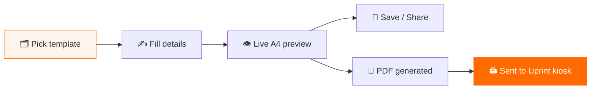
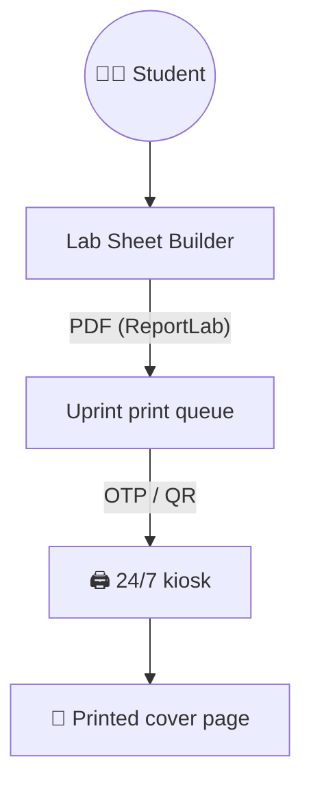

# 📄 Uprint Lab Sheet Builder

### Pick a template. Fill your details. Print in minutes.

A cover-page and lab-sheet builder for university students, built into **[Uprint](https://uprintbd.com)**, a 24/7 self-service printing kiosk network in Chattogram, Bangladesh.

---

## ⚡ The problem → the fix

> Students rewrite the same cover page in Word before every lab, fight the formatting, then carry a USB stick to a print shop.

**Uprint Lab Sheet Builder** turns that into a 60-second flow, from template to printed page, without leaving the browser.

---

## ✨ Features

| | Feature | What it does |
|:-:|---|---|
| 🗂️ | **Template gallery** | Ready-made covers for lab reports and assignments, plus a blank version to fill in by hand |
| 🔍 | **Search & filters** | Filter by Lab Report, Assignment, Cover Page, Blank or *Recently Used* |
| 👁️ | **Live A4 preview** | Every keystroke updates a true-to-print A4 page |
| 🔤 | **Flexible styling** | Change fonts and adjust the layout to match a department's format |
| 💾 | **My Templates** | Save filled sheets and reuse them for the next lab |
| 🔗 | **Share** | Send a filled template to classmates in one link |
| 🖨️ | **One-click print** | PDF goes straight into the Uprint print order, no download needed |

---

## 🧩 Templates

| Template | Best for | Try it |
|---|---|:-:|
| Lab Report Cover | Experiment details, one teacher | [Open →](https://uprintbd.com/uprint/lab-sheets/new/lab-report/) |
| Lab Report Cover · Two Teachers | Labs with two course teachers | [Open →](https://uprintbd.com/uprint/lab-sheets/new/lab-report-2t/) |
| Assignment Cover | Topic, course, teacher and student | [Open →](https://uprintbd.com/uprint/lab-sheets/new/assignment-cover/) |
| Assignment Cover · Style 2 | Course-first layout | [Open →](https://uprintbd.com/uprint/lab-sheets/new/assignment-cover-2/) |
| Blank Cover Page | Fill in by hand | [Open →](https://uprintbd.com/uprint/lab-sheets/new/blank-cover/) |

---

## 🏗️ How it fits into Uprint

---

## 👨‍💻 My role

- Designed and built the feature end to end: template gallery, editor with live preview, save/share, PDF generation and print hand-off
- Built as a self-contained Django app (`lab_templates`) that plugs into the existing Uprint platform
- Shipped to production at **[uprintbd.com](https://uprintbd.com/uprint/lab-sheets/)**

---

**Part of the Uprint platform:**
[📄 Uprint Lab Sheet Builder](https://github.com/MSSohan/Uprint-Lab-Sheet-Builder) ·
[📍 Find Nearest Uprint Kiosk](https://github.com/MSSohan/Find-Nearest-Uprint-Kiosk) ·
[🛠️ Uprint Kiosk Management](https://github.com/MSSohan/Uprint-Kiosk-Management)

The production source code is private. This repository is a showcase of the feature.

